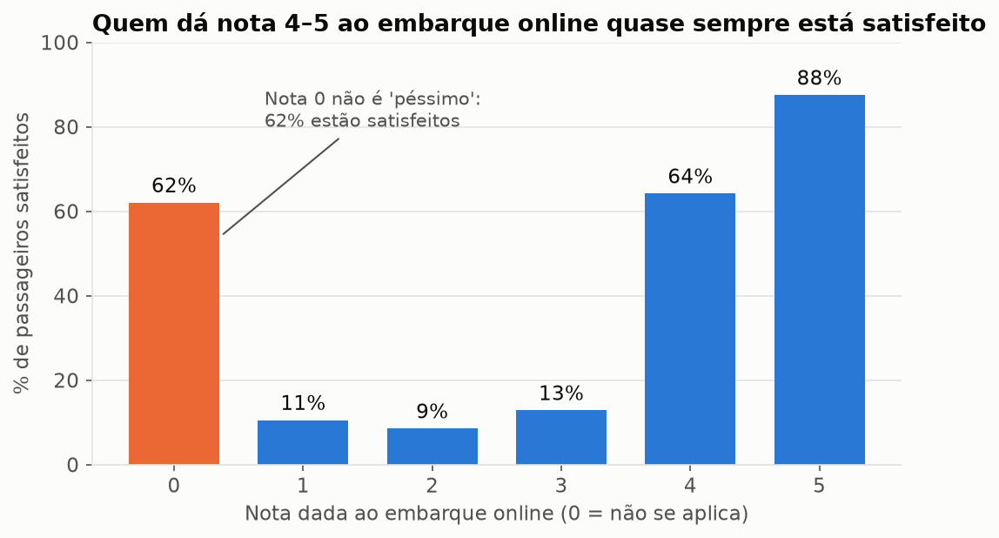
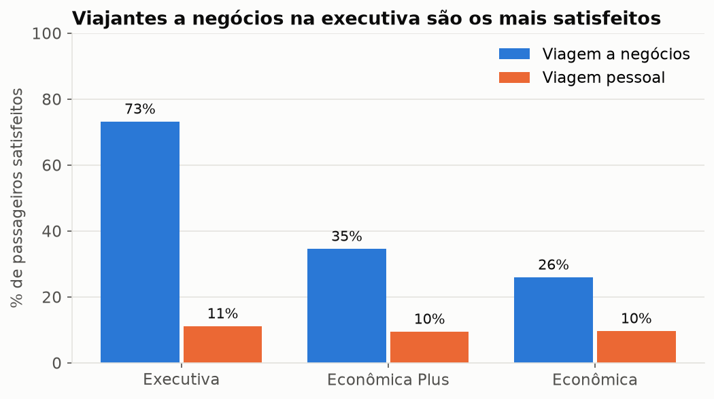
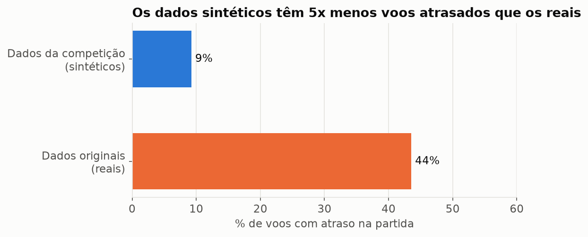
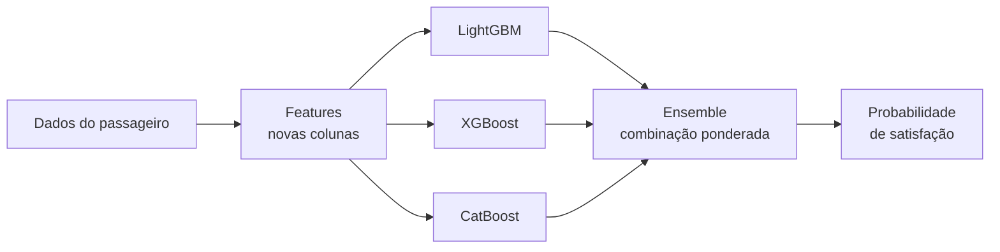

# ✈️ Prevendo a satisfação de passageiros aéreos

> Um modelo de machine learning que, a partir de uma pesquisa de bordo e de dados do voo,
> estima a chance de um passageiro sair **satisfeito**, e uma explicação de cada
> decisão tomada para chegar lá.

**Competição:** [Kaggle Playground Series S6E10](https://www.kaggle.com/competitions/playground-series-s6e10) ·
**Autor:** Fabio Simoes · 🇺🇸 [English summary](README_EN.md)

---

## 📊 Resultados em um relance

| Indicador | Valor | O que significa |
|---|---|---|
| **ROC AUC (validação)** | **0.9610** | Sorteando um passageiro satisfeito e um insatisfeito, o modelo coloca o satisfeito à frente em **96 de cada 100** pares |
| **ROC AUC (placar público)** | **0.9604** | O mesmo número medido pelo Kaggle em dados que o modelo nunca viu: o resultado se sustenta fora de casa |
| **Posição** | **~1253 de 2907** (top 43%) | Começou em ~1569; subiu ao identificar e fechar uma lacuna de *features* |
| **Experimentos registrados** | 20 | Todos reproduzíveis com um comando, incluindo os que não funcionaram |


---

## 🎯 O problema, em palavras simples

Companhias aéreas fazem pesquisas de satisfação, mas só uma parte dos passageiros
responde ao final. Saber **quem provavelmente está insatisfeito** permite agir antes, por
exemplo com um contato pós-voo, um upgrade ou a correção do serviço que mais pesa.

O desafio: dadas informações de ~1 milhão de passageiros (perfil, voo e notas de 0 a 5
para 13 serviços), estimar para cada um a **probabilidade de estar satisfeito**.

> **Por que probabilidade e não "sim/não"?** A métrica da competição (ROC AUC) avalia se
> o modelo *ordena* bem os passageiros, do mais provável ao menos provável. Uma
> probabilidade permite à empresa escolher onde cortar: contatar os 5% mais insatisfeitos
> ou os 20%, conforme o orçamento.

## 🗂️ Os dados

Cada linha é um passageiro. As colunas se dividem em quatro grupos:

| Grupo | Exemplos |
|---|---|
| Perfil | idade, gênero, cliente fiel ou não |
| Viagem | classe (executiva, econômica plus, econômica), motivo (negócios ou pessoal), distância |
| Pesquisa de bordo (0 a 5) | Wi-Fi, embarque online, conforto do assento, limpeza, entretenimento… |
| Pontualidade | minutos de atraso na partida e na chegada |

São 699.635 passageiros com resposta conhecida (treino) e 299.844 a prever (teste).

> ⚠️ **Transparência:** os dados são **sintéticos**, gerados pelo Kaggle a partir de um
> [conjunto real e público](https://www.kaggle.com/datasets/teejmahal20/airline-passenger-satisfaction)
> de 130 mil passageiros. Os padrões gerais são realistas, mas algumas técnicas usadas
> aqui exploram características do processo de geração e não valeriam para dados reais
> (indicado abaixo onde se aplica).

---

## 🔎 O que descobrimos nos dados

Cada descoberta abaixo levou a uma decisão concreta.

### 1. O embarque online é o termômetro da satisfação



- **Achado:** quem dá nota 4–5 ao embarque online está satisfeito em 64–88% dos casos;
  com nota 1–3, só 9–13%. Sozinha, essa nota já ordena corretamente 85% dos pares.
- **Curiosidade:** a nota **0** não significa "péssimo": 62% desses passageiros estão
  satisfeitos. O 0 indica "não se aplica" (quem não usou o serviço).
- **Decisão:** usar modelos baseados em **árvores de decisão**, que lidam naturalmente
  com relações "em U" como essa, sem precisar tratar o 0 à mão.

### 2. Perfil importa: executiva a negócios é outro mundo



- **Achado:** 73% dos viajantes a negócios na executiva estão satisfeitos; em viagens
  pessoais, apenas ~10%, qualquer que seja a classe.
- **Decisão:** manter classe e motivo da viagem como colunas centrais e combiná-las em
  pares (classe × motivo) na etapa de *features*.

### 3. Os dados de treino e de teste são "gêmeos"; os dados reais, não



- **Achado:** treinamos um modelo para tentar distinguir linhas de treino de linhas de
  teste e ele não conseguiu (nota 0.50, puro acaso). Já entre os dados sintéticos e os
  reais ele acerta com facilidade (0.83), principalmente porque os sintéticos têm
  **5x menos voos atrasados**.
- **Decisão 1:** como treino e teste são parecidos, nossa validação interna prevê bem o
  placar do Kaggle. Isso se confirmou: o placar ficou sempre entre 0.0004 e 0.0007 abaixo da validação, mantendo a mesma ordem entre os modelos.
- **Decisão 2:** **não** misturar os dados reais ao treino como linhas extras (testamos:
  piorou) e, em vez disso, usá-los como **fonte de pistas** (ver "o que funcionou").

---

## ⚙️ Como a solução funciona



1. **Features:** criamos colunas novas que ajudam o modelo a enxergar padrões (detalhes abaixo).
2. **Três modelos de árvores de decisão** (LightGBM, XGBoost, CatBoost). Cada um faz
   milhares de perguntas simples em sequência ("embarque online ≥ 4?", "classe
   executiva?"), e cada nova árvore corrige os erros das anteriores.
3. **Ensemble:** combinamos os modelos. Como cada um erra em lugares diferentes, a
   combinação acerta mais que qualquer um sozinho, como pedir a opinião de três
   especialistas em vez de um.

<details>
<summary><b>🤔 Por que árvores de decisão e não redes neurais?</b></summary>

Em dados de tabela (linhas e colunas), modelos de árvores com *boosting* continuam sendo o
estado da arte na prática: treinam em minutos, lidam sozinhos com valores faltantes e
relações não lineares, e mostram quais colunas pesam mais. Redes neurais tabulares podem
somar um pouco num ensemble, mas com custo e complexidade bem maiores; ficaram fora do
escopo, escolhido para ser competitivo **e** explicável.
</details>

<details>
<summary><b>🤔 Como sabemos que o modelo não está "decorando" as respostas?</b></summary>

Usamos **validação cruzada**: dividimos os dados de treino em 5 partes, treinamos com 4 e
testamos na quinta, rodando 5 vezes, como fazer 5 simulados diferentes antes da prova.
Toda decisão foi tomada olhando esse "simulado", nunca o placar do Kaggle. A prova de que
funciona: o placar público (dados nunca vistos) ficou sempre a menos de 0.001 do simulado.
</details>

---

## 🧪 A jornada: o que funcionou e o que não funcionou

| Etapa | AUC | Veredito | Por quê |
|---|---|---|---|
| Modelo padrão (ponto de partida) | 0.9583 | — | Referência |
| Somar os dados reais como linhas extras | 0.9581 | ❌ | Distribuições diferentes demais confundem o modelo |
| Colunas "de negócio" (atraso total, média das notas) | 0.9583 | ❌ | As árvores já combinavam essas informações sozinhas |
| Ajuste automático de hiperparâmetros (Optuna) | 0.9591 | ✅ | Encontrou o equilíbrio certo entre complexidade e generalização |
| **Diagnóstico:** placar público abaixo da mediana | | 🔍 | Leitura dos melhores notebooks públicos apontou o que faltava |
| + Dígitos dos números (idade, distância, atrasos) | 0.9595 | ✅* | *Explora padrões do gerador sintético, sem valor em dados reais |
| + Frequência de cada valor | 0.9597 | ✅* | Valores raros se comportam diferente |
| + Dados reais **como pistas** | 0.9603 | ✅ | A taxa de satisfação real de cada perfil é um sinal valioso |
| + *Target encoding* | 0.9605 | ✅ | Resume para cada valor a taxa de satisfação vista no treino |
| **Ensemble de 7 modelos** | **0.9610** | ✅ | Modelos diferentes erram em lugares diferentes |

**Lição principal:** o maior salto não veio de modelos mais sofisticados, e sim de
**representar melhor os dados**: +0.0014, quase o dobro do ganho do ajuste de hiperparâmetros (+0.0008). E a lacuna só apareceu porque comparamos o
resultado com o placar público e com o que a comunidade estava fazendo. Hoje esse
passo está registrado nas [skills](docs/skills.md) para acontecer logo no início dos
próximos projetos.

**Um bug que valeu a história:** a primeira versão do ensemble "escolhia" só um modelo
sem avisar nada. O algoritmo clássico só testava misturas 50/50 no primeiro passo, e todas
pioravam. Corrigido com teste automatizado; agora ele testa frações de 5% a 50%.

---

## 🚀 Com mais tempo ou em produção

- **Stacking com meta-modelo e redes neurais tabulares:** o topo do placar (~0.962) usa
  isso, com ganho de ~0.001 e custo alto de complexidade.
- **Retirar as features de artefato** (dígitos, frequência) em dados reais e medir de novo.
- **Explicabilidade por passageiro** (SHAP): "este passageiro tem risco alto por causa
  do Wi-Fi e do embarque", útil para a equipe de atendimento.
- **Monitoramento:** acompanhar se o perfil dos passageiros muda (a mesma técnica de
  "treino × teste" serve para detectar isso) e retreinar quando necessário.

---

## 🧠 Skills de IA criadas neste projeto

Além do modelo, o projeto produziu **6 skills para o Claude Code**: procedimentos que um
assistente de IA segue sozinho para acelerar projetos futuros (Kaggle, consultoria,
produtos de dados). Elas ficam em [`.claude/skills/`](.claude/skills/) e estão explicadas
em [docs/skills.md](docs/skills.md).

| Skill | Para quê |
|---|---|
| `kickoff-tabular-competition` | Do zero a um ciclo de validação confiável na primeira hora |
| `exploring-tabular-data` | Análise exploratória orientada a decisões, com validação adversarial |
| `running-cv-experiments` | Experimentos comparáveis, registrados e sem vazamento |
| `ensembling-oof-predictions` | Combinar modelos do jeito certo para cada métrica |
| `submitting-to-kaggle` | Validar e enviar submissões com segurança |
| `writing-ml-portfolio-docs` | Documentação que não técnicos entendem (como esta) |

---

## 🛠️ Como reproduzir

```bash
uv sync                                    # ambiente (Python 3.10+)
./scripts/download_data.sh                 # dados da competição + dataset original
python scripts/run_experiment.py --list    # experimentos disponíveis
python scripts/tune.py lgbm                # ajuste de hiperparâmetros (opcional; JSONs já versionados)
python scripts/run_experiment.py lgbm_fe_final xgb_fe_final cat_fe_final \
    lgbm_fe_digits lgbm_fe_freq lgbm_fe_orig xgb_tuned_orig
python scripts/build_ensemble.py           # ensemble + submissions/ensemble_auc_*.csv
python scripts/make_figures.py             # figuras desta página
uv run pytest                              # testes
```

XGBoost e CatBoost usam GPU NVIDIA; sem GPU, remova `device`/`task_type` dos
experimentos em `scripts/run_experiment.py`.

**Estrutura:** `src/` (dados, features, encoders, validação, ensemble, registro) ·
`scripts/` (execução) · `experiments/results.csv` (histórico completo) · `docs/`
([guia de leitura do código](docs/guia_de_leitura.md), [metodologia técnica](docs/metodologia.md), [skills](docs/skills.md),
[visão da competição](docs/competition_overview.md)) · `tests/`.

---

## 📖 Glossário

| Termo | Explicação simples |
|---|---|
| **ROC AUC** | Probabilidade de o modelo ordenar corretamente um par (satisfeito, insatisfeito). 0.5 = chute; 1.0 = perfeito |
| **Validação cruzada** | Treinar e testar várias vezes em partes diferentes dos dados para medir o desempenho de forma honesta |
| **OOF (out-of-fold)** | Previsões que cada modelo fez sobre dados que não viu no treino; base da validação e do ensemble |
| **Feature** | Uma coluna usada pelo modelo, original ou criada a partir de outras |
| **Target encoding** | Trocar cada valor pela taxa de satisfação observada para ele, calculada sem olhar a própria linha |
| **Vazamento (leakage)** | Quando o modelo "vê a resposta" durante o treino e parece melhor do que é |
| **Gradient boosting (GBDT)** | Família de modelos que soma milhares de árvores pequenas, cada uma corrigindo a anterior |
| **Hiperparâmetros** | Configurações do modelo (profundidade das árvores, velocidade de aprendizado) |
| **Ensemble** | Combinação de vários modelos |
| **Validação adversarial** | Treinar um modelo para distinguir dois conjuntos de dados; se ele não consegue, os conjuntos são parecidos |
| **Dados sintéticos** | Dados gerados por computador imitando dados reais |

---

### Créditos

Ideias de *features* da rodada 3 inspiradas em notebooks públicos da competição,
especialmente [evgendvorkin/s6e10-lightgbm-cv-5-folds-0-96111](https://www.kaggle.com/code/evgendvorkin/s6e10-lightgbm-cv-5-folds-0-96111);
a implementação, os testes e a análise são deste repositório. Dataset original:
[Airline Passenger Satisfaction (teejmahal20)](https://www.kaggle.com/datasets/teejmahal20/airline-passenger-satisfaction).
