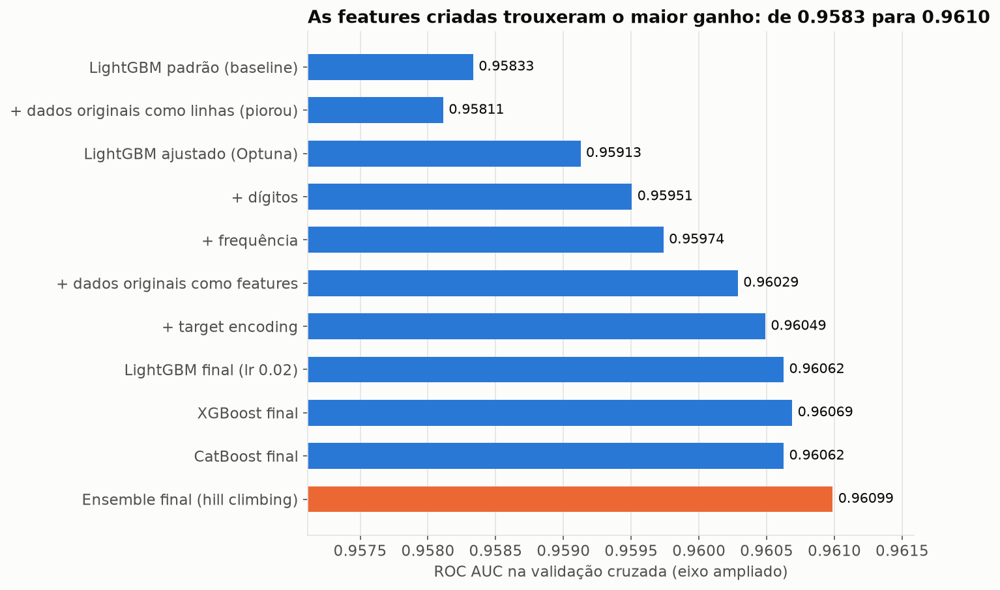

# ✈️ Predicting Airline Passenger Satisfaction

> A machine learning model that estimates how likely a passenger is to be **satisfied**,
> from an in-flight survey and flight data, with the reasoning behind every decision.

**Competition:** [Kaggle Playground Series S6E10](https://www.kaggle.com/competitions/playground-series-s6e10) ·
**Author:** Fabio Simoes · 🇧🇷 [Full version in Portuguese](README.md)

## Results at a glance

| Metric | Value | Meaning |
|---|---|---|
| **ROC AUC (cross-validation)** | **0.9610** | For 96 of every 100 random (satisfied, unsatisfied) pairs, the model ranks the satisfied passenger higher |
| **ROC AUC (public leaderboard)** | **0.9604** | Same metric on unseen data; validation tracked the leaderboard within 0.001 on every submission |
| **Rank** | **~1253 / 2907** (top 43%) | Up from ~1569 after diagnosing a feature-engineering gap |
| **Logged experiments** | 20 | Each reproducible with one command, failures included |

## The problem

Airlines survey passengers, but only some answer. Knowing **who is likely unsatisfied**
lets them act early (follow-up contact, service fixes). Given ~1M passengers (profile,
trip, 0–5 ratings for 13 services, delays), predict the probability of satisfaction.
The metric, ROC AUC, rewards *ranking* passengers well, so the business can choose how
many to contact.

The data is **synthetic**, generated by Kaggle from a
[public real dataset](https://www.kaggle.com/datasets/teejmahal20/airline-passenger-satisfaction).
Some techniques below exploit generator artifacts and are flagged as such.

## Key findings → decisions

1. **Online boarding is the satisfaction thermometer.** Ratings of 4–5 mean 64–88%
   satisfied; 1–3 mean 9–13%. A rating of **0 means "not applicable"** (62% satisfied),
   not "terrible". → Tree-based models handle this U-shape natively.
2. **Business travelers in business class are 73% satisfied; personal travelers ~10%**,
   whatever the class. → Class × travel type pairs are used in target encoding.
3. **Train and test are indistinguishable (adversarial AUC 0.50); synthetic vs. real data
   is not (0.83)**, since synthetic flights are delayed 5× less often. → Local CV is trustworthy.
   Real data hurt as extra rows but helped as *features*.

## Solution

Feature engineering → three gradient-boosted tree models (LightGBM, XGBoost, CatBoost on
GPU) → rank-based hill-climbing ensemble. All models share fixed 5-fold stratified splits.
Target-dependent encoders are fit inside each fold with inner cross fitting, so the
validation score can't leak labels.

## Experiment journey

| Step | CV AUC | Verdict |
|---|---|---|
| Default LightGBM baseline | 0.9583 | — |
| Real data appended as rows | 0.9581 | ❌ distribution shift |
| Hand-crafted domain features | 0.9583 | ❌ trees already capture them |
| Optuna hyperparameter tuning | 0.9591 | ✅ |
| *Diagnosis: public LB below the median → studied top public notebooks* | | 🔍 |
| + digit features* | 0.9595 | ✅ (*synthetic-generator artifact) |
| + value frequencies* | 0.9597 | ✅ |
| + real data as features (per-value target means + auxiliary model) | 0.9603 | ✅ |
| + in-fold target encoding (columns and pairs) | 0.9605 | ✅ |
| **Ensemble of 7 models** | **0.9610** | ✅ |

**Main lesson:** better data representation (+0.0014) beat model tuning (+0.0008), and
the gap only surfaced by benchmarking against the public leaderboard and the community.
**A bug worth telling:** classic hill climbing silently collapsed to a single model
(its forced 50/50 first step always hurt). Fixed with fractional steps and a regression test.

## Reusable AI skills

The project also produced **6 Claude Code skills** ([`.claude/skills/`](.claude/skills/),
explained in [docs/skills.md](docs/skills.md), in Portuguese) that encode the workflow
for future Kaggle, consulting and data-product work: competition kickoff, decision-driven
EDA with adversarial validation, leakage-safe CV experiments, OOF ensembling, safe Kaggle
submission, and portfolio documentation for non-technical readers.

## Reproduce

See "Como reproduzir" in the [Portuguese README](README.md) (commands are language-neutral)
and [docs/metodologia.md](docs/metodologia.md) for the technical deep dive.

Feature ideas in round 3 were inspired by public competition notebooks, notably
[evgendvorkin/s6e10-lightgbm-cv-5-folds-0-96111](https://www.kaggle.com/code/evgendvorkin/s6e10-lightgbm-cv-5-folds-0-96111);
implementation, tests and analysis are original to this repository.
