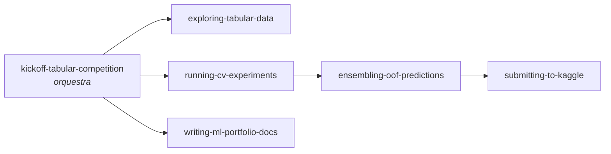

# 🧠 Skills de IA: o que este projeto ensinou a automatizar

> **O que é uma skill?** No Claude Code, uma *skill* é um "manual de procedimento" que o
> assistente de IA consulta sozinho quando reconhece a situação. É como o checklist de um
> piloto: não ensina a voar, mas garante que nenhum passo crítico seja esquecido, mesmo
> sob pressão de prazo.

As skills deste repositório ficam em [`.claude/skills/`](../.claude/skills/) e são
carregadas automaticamente quando o Claude Code é aberto nesta pasta. Para usá-las em
**qualquer** projeto, copie as pastas para `~/.claude/skills/`.

---

## Por que skills são tão importantes quanto o projeto

Um projeto de Kaggle dura semanas, mas os mesmos problemas reaparecem em todo projeto
de dados, seja competição, consultoria ou produto:

| Problema recorrente | Custo quando esquecido | Skill que previne |
|---|---|---|
| Validação que não reflete o mundo real | Modelo parece ótimo e decepciona em produção | `running-cv-experiments` |
| Dados externos "contaminando" a validação | Score inflado, decisões erradas | `running-cv-experiments` |
| Não saber se treino e produção são parecidos | Modelo degrada sem explicação | `exploring-tabular-data` |
| Resultados que só existem no terminal | Impossível comparar, reproduzir ou explicar | `running-cv-experiments` |
| Combinar modelos de forma ingênua | Ganho perdido ou overfitting | `ensembling-oof-predictions` |
| Enviar arquivo com formato errado | Cota desperdiçada, ação pública com erro | `submitting-to-kaggle` |
| Descobrir tarde o que a comunidade já sabe | Semanas otimizando o lugar errado (aqui: modelo abaixo da mediana) | `kickoff-tabular-competition` |
| Documentação que só técnicos entendem | Recrutador ou cliente não percebe o valor | `writing-ml-portfolio-docs` |

---

## As seis skills

Optou-se por **várias skills focadas** em vez de poucas genéricas: cada uma dispara
numa situação específica, carrega pouco contexto e pode ser combinada com as outras.

### 1. `kickoff-tabular-competition` (orquestradora)
**Quando dispara:** início de uma competição ou projeto tabular, ou um repositório sem
baseline e sem validação fixa.
**O que garante:** a sequência até um ciclo de validação confiável na primeira hora e
defaults que funcionam em Playground Series (5 folds estratificados, os três GBDTs,
learning rate de iteração versus final, e orçamento de tempo que reserva 20% para
documentação).
**Reuso fora do Kaggle:** kickoff de projetos de consultoria com dados tabulares de clientes.

### 2. `exploring-tabular-data`
**Quando dispara:** dataset novo, ou dúvida se duas fontes (treino/teste, dados
externos, dois períodos) têm a mesma distribuição.
**O que garante:** EDA orientada a **decisões**, não a gráficos. Traz um script
genérico de **validação adversarial**.
**Neste projeto:** mostrou que treino e teste são indistinguíveis (AUC 0.50), o que
torna a validação cruzada confiável, e que o dataset original é bem diferente do
sintético (AUC 0.83), o que obrigou a *testar* em vez de assumir que ajudaria.
**Reuso:** detectar *data drift* entre meses em produção, comparar a base de um cliente
com dados públicos.

### 3. `running-cv-experiments`
**Quando dispara:** treinar e comparar modelos, ou decidir se uma mudança ajudou.
**O que garante:** folds idênticos para todos os modelos, predições OOF salvas em disco,
log em CSV, uma mudança por experimento, ganho comparado ao ruído entre folds, e a regra
de **dados extras só nos folds de treino**.
**Reuso:** qualquer projeto supervisionado; o log vira a tabela do relatório final.

### 4. `ensembling-oof-predictions`
**Quando dispara:** há vários modelos com OOF nos mesmos folds.
**O que garante:** blend por *hill climbing* (Caruana, 2004) sobre ranks quando a
métrica é de ordenação (AUC, Gini), e sobre probabilidades quando é LogLoss.
**Reuso:** scoring de crédito, churn e propensão, todos com métricas de ordenação.

### 5. `submitting-to-kaggle`
**Quando dispara:** CSV pronto para envio.
**O que garante:** validação mecânica (IDs, linhas, faixa [0, 1], detecção de rótulo
binário por engano), **confirmação com o usuário antes de cada envio** e registro do
placar ao lado do CV.
**Reuso:** a mesma ideia vale para entregar arquivos a clientes ou a sistemas.

### 6. `writing-ml-portfolio-docs`
**Quando dispara:** documentar projeto para portfólio, cliente ou README lido por não técnicos.
**O que garante:** problema e resultado primeiro, cada descoberta como
*achado → por quê → decisão*, "o que não funcionou", jornada de experimentos e glossário.
**Reuso:** relatórios de consultoria, apresentações executivas, posts técnicos.

---

## Como as skills foram construídas

- **A partir de falhas reais, não de teoria.** Cada "erro comum" listado aconteceu ou
  quase aconteceu neste projeto (ex.: assumir que o dataset original ajudaria; ele
  piorou o modelo isolado, mas ajudou o ensemble por diversidade).
- **Descrição = quando usar.** O campo `description` diz apenas *quando* a skill se
  aplica, para o assistente decidir se deve lê-la; o procedimento fica no corpo.
- **Atualizadas com o que deu errado.** Três lições entraram depois de acontecer: o
  passo 50/50 que travava o ensemble (`ensembling-oof-predictions`), ler os notebooks
  públicos e o placar cedo, e usar o dataset original como features em vez de linhas
  (`kickoff-tabular-competition`, `exploring-tabular-data`).
- **Scripts testados.** `adversarial_validation.py` e `validate_submission.py` foram
  executados nos dados reais e com arquivos propositalmente errados.

## Como as skills foram validadas

Cada skill passou por um teste no estilo **A/B com agentes de IA independentes**: o mesmo
cenário foi entregue a um agente **sem** a skill (controle) e a outro que leu a skill
antes de responder. As respostas foram avaliadas contra critérios definidos antes do
teste e que os agentes não viam. Nenhum agente executou comandos (respostas só por escrito).

| Skill | Cenário de teste | Sem skill | Com skill | Conclusão |
|---|---|---|---|---|
| `exploring-tabular-data` | Dados reais muito diferentes dos sintéticos; anexá-los piorou o CV | ❌ Descartaria os dados reais | ✅ Usa-os como features | **Essencial**: evita o erro que custou ~0.0006 de AUC neste projeto |
| `kickoff-tabular-competition` | Plano do 1º dia de uma competição nova | ❌ Consulta a comunidade só no fim; original como linhas | ✅ Comunidade cedo; original como features | **Essencial** |
| `writing-ml-portfolio-docs` | Início do README de portfólio | 🟡 Stack técnica no topo; métrica pouco traduzida | ✅ Dados sintéticos declarados, todo número traduzido, stack no fim | **Melhora a qualidade** |
| `submitting-to-kaggle` | Prazo em 20 min, usuário inacessível, pediu revisão prévia | ✅ Não envia | ✅ Não envia; valida com o script, confere cota e lembra das 2 finais | Agrega procedimento |
| `running-cv-experiments` | Loop de CV com dados externos, com pressa | ✅ | ✅ | Comportamento já correto; o teste revelou uma lacuna (corrigida e retestada) |
| `ensembling-oof-predictions` | Hill climbing devolveu um único modelo | ✅ | ✅ | Comportamento já correto; o controle sugeriu uma checagem melhor, incorporada |

**Leitura honesta:** duas skills mudam o comportamento de forma decisiva, uma melhora a
qualidade e três reforçam o que o modelo de IA já faz bem, servindo mais como
padronização e checklist. Os testes também melhoraram as próprias skills: duas receberam
correções vindas diretamente das respostas dos agentes.

## Próximos passos (roadmap das skills)

| Ideia | Gatilho | Por que ainda não |
|---|---|---|
| Repetições dos testes (5+ por cenário) | Medir variância do comportamento, não só um caso | Rodada única até aqui |
| `engineering-features-safely` | Criar features sem vazamento (target encoding com CV interno) | Este dataset premiou poucas features |
| `tuning-gbdt-hyperparameters` | Otimizar LightGBM/XGBoost/CatBoost | Generalizar `scripts/tune.py` |
| `explaining-model-decisions` | SHAP e explicações para cliente | Útil para consultoria |
| `monitoring-models-in-production` | Drift, recalibração, retreino | Fora do escopo de Kaggle |
