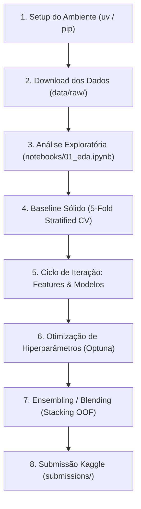

# 🔬 Guia de Fluxo de Trabalho e Registro de Experimentos

Este guia detalha o fluxo de trabalho sugerido para desenvolver a solução do desafio Kaggle Playground Series S6E10.

---

## 🔄 Fluxo de Trabalho (Pipeline)



---

## 🛠️ Passo a Passo Prático

### 1. Configurar o Ambiente

```bash
uv sync
source .venv/bin/activate
```

### 2. Obter os Dados da Competição

Se você já possui as credenciais configuradas (`~/.kaggle/kaggle.json`):
```bash
./scripts/download_data.sh
```

Ou manualmente pelo site do Kaggle:
- Baixe os arquivos da página da competição.
- Extraia-os na pasta `data/raw/` (`train.csv`, `test.csv`, `sample_submission.csv`).

### 3. Rodar Análise Exploratória
Abra o Jupyter:
```bash
jupyter lab
```
Execute o notebook [`notebooks/01_eda.ipynb`](../notebooks/01_eda.ipynb) para entender a distribuição dos dados e identificar padrões.

### 4. Executar o Baseline
Você pode rodar via script:
```bash
python scripts/run_baseline.py
```
Ou pelo notebook interativo [`notebooks/02_baseline_model.ipynb`](../notebooks/02_baseline_model.ipynb).

---

## 📝 Tabela de Registro de Experimentos

Utilize esta tabela para documentar cada iteração e garantir que você só submete melhorias com validação confirmada.

| ID | Descrição do Experimento | Modelo | Features Usadas | CV OOF (ROC AUC) | Public LB | Comentários |
| :---: | :--- | :---: | :--- | :---: | :---: | :--- |
| **EXP-001** | Baseline inicial | LightGBM | Features brutas (Ordinal encode) | *Aguardando execução* | - | Ponto de partida |
| **EXP-002** | Baseline CatBoost | CatBoost | Features com categoricals nativos | - | - | Comparação com LightGBM |
| **EXP-003** | Baseline XGBoost | XGBoost | Hist method | - | - | Comparação de modelo |
| **EXP-004** | Feature Engineering | LightGBM | + Total delay + Survey aggregations | - | - | Avaliar ganho de features |
| **EXP-005** | Tuning Hiperparâmetros | LGBM/CatBoost | Best features + Optuna | - | - | Ajuste de profundidade/lr |
| **EXP-006** | Blending / Stacking | Ensemble | OOF de LGBM + CatBoost + XGBoost | - | - | Combinação ponderada |

---

## ⚠️ Regras de Ouro para Kaggle Tabular

1. **Confie na sua Validação Local (CV):** O Public Leaderboard usa apenas uma fração do conjunto de teste. Decisões tomadas com base em pequenas variações no LB público frequentemente causam *shakeup* no resultado final.
2. **Mesma Semente e Mesmos Folds:** Sempre utilize os mesmos splits de validação para todos os modelos que você pretende combinar no ensemble, garantindo que as predições Out-Of-Fold (OOF) sejam perfeitamente alinhadas.
3. **Submissões Probabilísticas:** Como a métrica é ROC AUC, verifique sempre se a coluna predita contém probabilidades contínuas (ex: `0.7421`), e não rótulos inteiros (0 ou 1).
